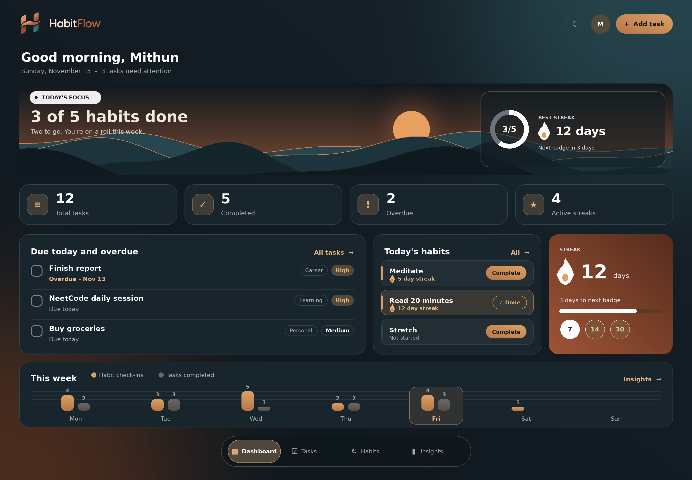
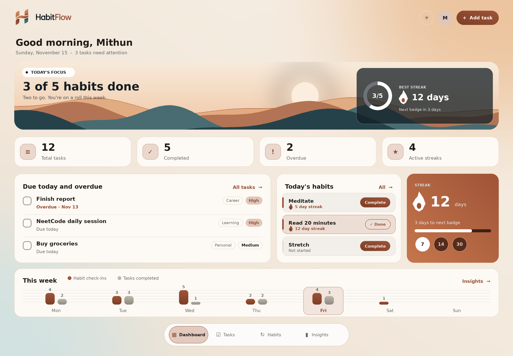
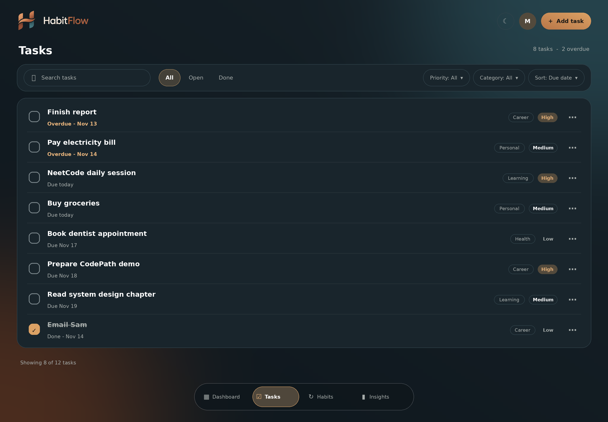
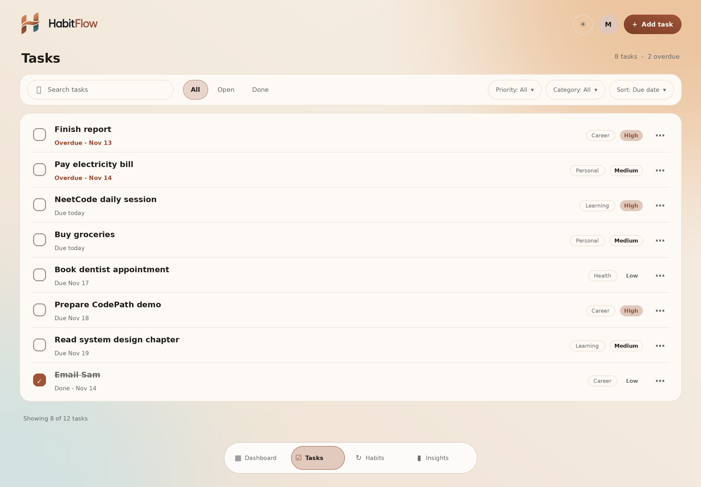
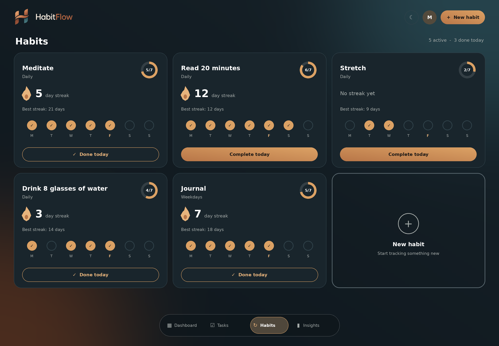
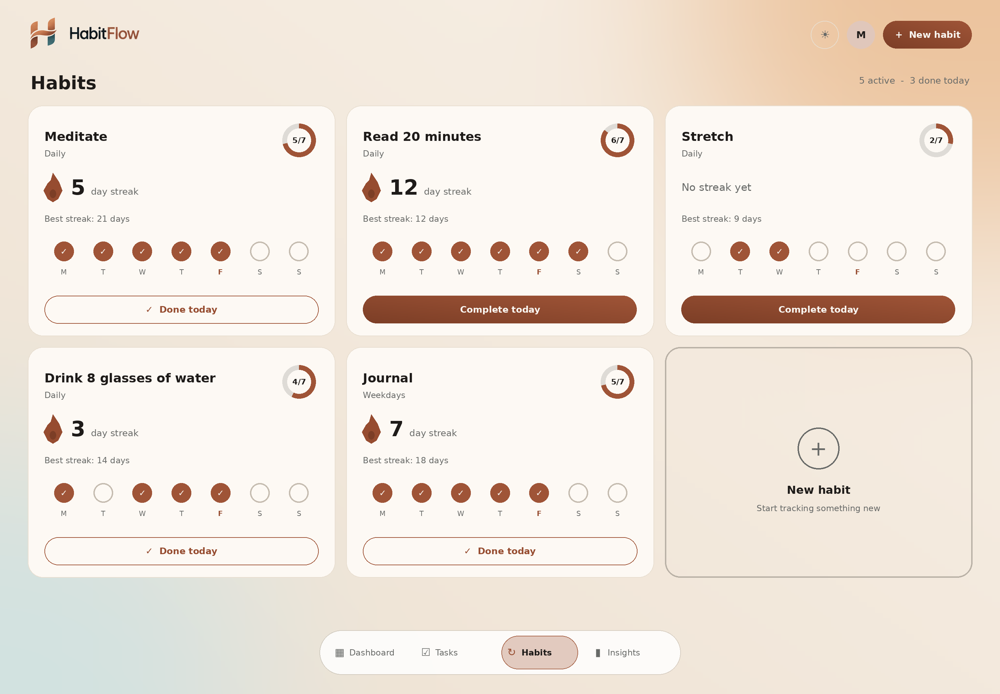
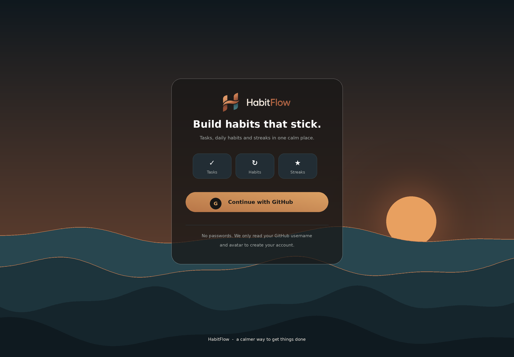
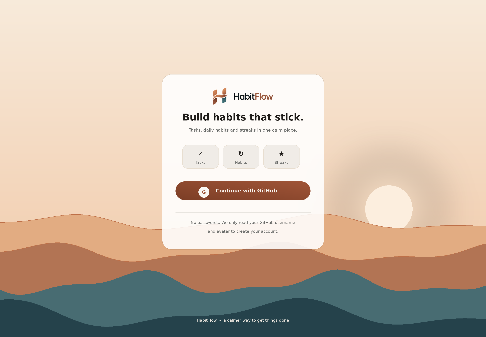

# HabitFlow UI Redesign (Brand Edition): Implementation Plan

**Goal:** give HabitFlow a market-ready look using **your brand**: the copper / teal / cream palette and the "H" logo from your brand board, in dark and light themes, with a bottom dock for navigation and a sunset-landscape hero.

**Scope:** a frontend-only restyle. The backend, API and data model do not change in Phases 0–7. Phase 8 is optional and adds small backend features.

**How to use this folder:** open it in Claude Code or Cursor and attach the images in `mockups/` and `reference/`. Work one phase at a time with the prompts in section 7. Commit after each phase.

```
HabitFlow_UI_Redesign/
  PLAN.md
  mockups/     Brand_<page>_<dark|light>.png   (dashboard, tasks, habits, login)
  brand/       logo crops cut from your board (mark + wordmark, dark and light, app icons)
  reference/   your brand board and your own light/dark dashboard mock
```

> The mockups use a placeholder font. Use **Inter** (or Manrope) in the real build. Treat colour, spacing, hierarchy and layout as the target, not the exact glyphs.
> The files in `brand/` are cropped from the board image, so they are low resolution (about 100–240px). **Export your logo as SVG or a large PNG from the original and replace them.** See section 4.

---

## 0. What exists today (so the AI doesn't rewrite what works)

- **Stack:** React 19 + Vite 8 + react-router-dom 7, plain CSS in `frontend/src/styles/app.css` (about 950 lines). It is driven by CSS variables in `:root` (`--color-bg`, `--color-surface`, `--color-text`, `--color-muted`, `--color-border`, `--color-accent`, `--color-accent-soft`, `--radius`, `--content-width`). The font is `system-ui` and the layout has a top nav.
- **Shell:** `components/Layout.jsx` renders `app-shell`, `app-header` with `Navigation`, `app-main` with `<Outlet>`, and `app-footer` with `ResetDemoData`.
- **Nav:** `components/Navigation.jsx` has links Dashboard / Tasks / Habits / Insights, the avatar and username, and a sign-out button.
- **Pages:** `DashboardPage`, `TasksPage`, `HabitsPage`, `InsightsPage`, `LoginPage`, `TaskDetailsPage`, `HabitDetailsPage`, `NotFoundPage`.
- **Components:** `StatTile`, `TaskCard` / `TaskList` / `TaskFilters` / `TaskForm`, `HabitCard` / `HabitList` / `HabitForm`, `Modal` (native `<dialog>`), `WeeklyChart`, `CategoryTags`, `LoadingState`, `ErrorMessage`.
- **Data already available:** habit `current_streak`, `completed_today` and `frequency`; task `completed`, `due_date`, priority and categories; `GET /api/insights/weekly`, which includes `best_streak`.
- **Do not change** hooks, API calls, routes, auth, or existing class names where avoidable. Restyle through CSS and small JSX changes. This keeps the 168 backend tests and the existing behaviour safe.

## 1. Design direction

Your palette is the base: copper `#DBA164`, rust `#9F5437`, teal `#25424B`, ink `#141E25`, cream `#F2EADF`. The logo, the hero sunset and the bottom dock follow your own dashboard mock in `reference/`.

| Page | Dark | Light |
|---|---|---|
| Dashboard |  |  |
| Tasks |  |  |
| Habits |  |  |
| Login |  |  |

**Principles**
1. **Copper is the only accent.** It marks the primary button, the active dock item, completed checks, links, chart bars and streak highlights. Teal appears in surfaces, the second chart series and the landscape. Cream is the light background and the dark-mode text.
2. **Hierarchy through weight and tone, not extra colours.** Priority is a filled pill for High, an outline for Medium and muted text for Low. Overdue is bold copper text with an "Overdue" label.
3. **Depth.** A soft page gradient with a teal glow (dark) or a copper glow (light), layered rounded cards (radius 20–24px) with 1px borders, and frosted glass only on the dock and the hero panel.
4. **Sunset hero.** A layered-hills scene with a sun behind the greeting, built as inline SVG (see 4.3).
5. **Errors stay functional.** Keep a red/amber for real errors and destructive actions (`button-danger`, `ErrorMessage`). Brand colours are not used for errors.

## 2. Design tokens

Replace the `:root` block in `app.css` with the dark theme, add a `[data-theme="light"]` block, and keep the old variable names as aliases so existing rules keep working.

```css
:root, :root[data-theme="dark"] {
  color-scheme: dark;
  --bg-1:#162128; --bg-2:#0E161C;
  --bg-glow:#25424B;  --bg-glow-2:#4A2C1E;      /* teal top-right, copper bottom-left */
  --surface:#19252C;  --surface-2:#121C22;      /* cards / dock & glass base */
  --border:#30424A;
  --text:#F2EADF;     --muted:#A6ACAA;
  --accent:#DBA164;   --accent-2:#B87648;       --on-accent:#141A1E;
  --accent-soft:rgba(219,161,100,.16);
  --accent-text:#E8B47C;                         /* links and highlights on dark surfaces */
  --series-2:#56808C;                            /* second chart series (teal) */
  --streak-from:#562C1C; --streak-to:#9F5437;    /* streak card gradient */
  --scene-sky-top:#0F181E; --scene-sky-bottom:#7C4C34; --scene-sun:#E8A060;
  --scene-hill-1:#28464F; --scene-hill-2:#1D343C; --scene-hill-3:#15252C; --scene-hill-4:#0F1A20;
  --scene-ridge:#CC8052;
  --glass:rgba(18,28,34,.72); --glass-border:rgba(255,255,255,.14);
  --hero-text:#F2EADF; --hero-text-muted:#D4CEC6;
  --danger:#F08A8A;
}
:root[data-theme="light"] {
  color-scheme: light;
  --bg-1:#F7F0E7; --bg-2:#EEE1D1;
  --bg-glow:#ECC49E;  --bg-glow-2:#D2E2E0;
  --surface:#FDF9F4;  --surface-2:#FAF5EE;
  --border:#E8DED0;
  --text:#141E25;     --muted:#686A68;
  --accent:#9F5437;   --accent-2:#7C3E26;       --on-accent:#FAF4EC;
  --accent-soft:rgba(159,84,55,.12);
  --accent-text:#964C30;
  --series-2:#345C66;
  --streak-from:#9F5437; --streak-to:#C6764C;
  --scene-sky-top:#F7EADA; --scene-sky-bottom:#F0C6A4; --scene-sun:#FCEEDE;
  --scene-hill-1:#E2AC82; --scene-hill-2:#B27454; --scene-hill-3:#486C72; --scene-hill-4:#25424B;
  --scene-ridge:#BE7048;
  --glass:rgba(255,255,255,.80); --glass-border:rgba(0,0,0,.08);
  --hero-text:#141E25; --hero-text-muted:#4E5456;
  --danger:#B42318;
}
:root {
  /* legacy aliases so existing rules keep working */
  --color-bg:var(--bg-1); --color-surface:var(--surface); --color-text:var(--text);
  --color-muted:var(--muted); --color-border:var(--border);
  --color-accent:var(--accent); --color-accent-soft:var(--accent-soft);
  --radius:20px; --radius-sm:12px; --radius-pill:999px; --content-width:1360px;
  --font-sans:"Inter Variable", system-ui, -apple-system, "Segoe UI", Roboto, sans-serif;
}
body {
  background:
    radial-gradient(1100px 600px at 92% -10%, var(--bg-glow), transparent 62%),
    radial-gradient(900px 600px at -5% 105%, var(--bg-glow-2), transparent 60%),
    linear-gradient(160deg, var(--bg-1), var(--bg-2));
  background-attachment: fixed;
}
```

**Buttons:** primary buttons are a copper fill with `--on-accent` text, and an optional subtle gradient from `--accent` to `--accent-2`. In dark mode the fill is light and the text dark, and in light mode the reverse. Check every place that hard-codes white text on `--color-accent`.

**Typography:** install `@fontsource-variable/inter`. Page title 26–32px / 700 / `letter-spacing:-0.02em`. Card titles 17–18px / 700. Labels such as TODAY'S FOCUS and BEST STREAK are 10–11px / 700 / uppercase / `letter-spacing:.08em`.

**Contrast:** verify these in both themes. Cream text on `#9F5437`, `#141A1E` on `#DBA164`, muted text on `--surface`, and `--accent-text` on `--surface` should all be at least 4.5:1. The dark-mode muted colour and the light-mode `#686A68` should be nudged if any check fails.

## 3. Phases (one commit each)

### Phase 0: Branch and baseline
- `git checkout -b ui-redesign`.
- Run `npm install` and `npm run dev` in `frontend/`, and confirm the app works against the local backend.
- Take baseline screenshots for the PR's before/after.
- Run `npm run build` in `frontend/`. The build must stay green after every phase.

### Phase 1: Tokens, theming and brand assets (no layout change yet)
1. Add the tokens from section 2 to `app.css`, including the body background.
2. Add `components/ThemeToggle.jsx`: a sun/moon icon button that sets `document.documentElement.dataset.theme` and saves to `localStorage` (wrap the access in try/catch). On first visit, follow `prefers-color-scheme`.
3. Put a tiny inline script in `frontend/index.html` `<head>` that sets `data-theme` before first paint, to avoid a flash.
4. Replace hard-coded colours across `app.css` with variables. Search for `#`, `rgb(` and `white`. Fix primary-button text colour.
5. Add the font, and add the logo assets and favicon (section 4).

**Done when:** the whole existing app renders correctly in both themes with the old layout, and toggling is instant.

### Phase 2: App shell (header and bottom dock)
This follows your own mock in `reference/HabitFlow_Light_and_Dark_Dashboards.png`.
- **Header (top, not sticky):** the logo (mark plus wordmark) on the left. On the right are the theme toggle, the avatar and the primary page action ("Add task" on Dashboard and Tasks, "New habit" on Habits). The page title or greeting sits under the header.
- **Avatar menu:** the avatar opens a small popover with the username and **Sign out**, so the header stays clean. Keep the existing sign-out logic and errors from `Navigation.jsx`, and make the menu keyboard-accessible (Escape closes it, focus returns to the avatar).
- **Bottom dock (all screen sizes):** replace the top link list with a fixed, centred glass pill at the bottom (`position:fixed; bottom:24px; left:50%; transform:translateX(-50%)`), radius 32px, `backdrop-filter: blur(14px)`, background `--glass`. It has 4 items (icon plus label) for Dashboard, Tasks, Habits and Insights. The active item is a copper-tinted pill with a copper border and bold text. Below 480px, show icons only. Keep using `NavLink` and its `active` class.
- Add bottom padding to `app-main` (about 120px) so the dock never covers content, and keep `ResetDemoData` in the footer above that space.
- The page "Add task" button stays in the page header and opens the existing modal there. Do not build a global modal in this pass.

### Phase 3: Dashboard
See `Brand_dashboard_dark.png` and `Brand_dashboard_light.png`.
1. **Greeting:** "Good morning/afternoon/evening, {first name}" plus the date and "{n} tasks need attention".
2. **Hero:** a rounded-24 panel, 190px tall, with the Scene (sunset) behind it. On the left is a white pill "TODAY'S FOCUS", the headline "{done} of {total} habits done" in `--hero-text`, and a one-line subtitle. On the right is a glass panel with a progress ring (done/total), the best streak (flame icon, "{n} days") and "Next badge in {k} days". Use habit data already loaded (`completed_today`) and `best_streak` from insights. In light mode the glass panel is dark teal with white text so it stays readable.
3. **Stat tiles:** four cards: Total tasks, Completed, Overdue, Active streaks. Each has an icon in a soft copper square, a big number and a label. The current page has six tiles, so fold Incomplete and Completion % into `detail` text or drop them.
4. **Main row (3 columns):** Due today and overdue (tasks panel), Today's habits (compact `HabitCard`s), and a **Streak card** with a copper gradient (`--streak-from` to `--streak-to`), the big number, a progress bar to the next milestone and 7 / 14 / 30 milestone circles (filled when reached). Milestones are computed in the frontend from the streak value.
5. **This week:** restyle `WeeklyChart` in a full-width panel. Habit bars use `--accent`, task bars use `--series-2`, today's column gets a soft highlight, and gridlines are subtle.
6. Keep all existing loading and error states, restyled.

### Phase 4: Tasks page
See `Brand_tasks_*.png`.
- **Filter bar:** one rounded panel with the search input, the status tabs (All / Open / Done) as pills, and the Priority / Category / Sort selects as outlined pills. Restyle `TaskFilters` only. Do not change the filtering logic or the query params.
- **List:** a single rounded panel with 72px rows divided by hairlines: 26px rounded-square checkbox, title (16px/700), due text, a category chip (outline), a priority pill and the row actions. Completed rows are muted with a strikethrough, and the checked box is a copper fill.
- **Priority:** High is a filled pill (`--accent-soft` plus `--accent-text`), Medium is outlined, Low is muted text. Overdue is bold `--accent-text` with the word "Overdue".
- **Row actions:** keep the existing Edit/Delete buttons but make them quiet (visible on hover/focus, always visible on touch). The `⋯` menu in the mockup is optional, so don't add a new menu component unless time allows.
- Footer text "Showing X of Y tasks".
- Restyle the create/edit `Modal` (`<dialog>`): radius 24, `--surface`, a dimmed and blurred backdrop, and the primary button in copper.

### Phase 5: Habits page
See `Brand_habits_*.png`.
- A 3-column responsive grid (`repeat(auto-fill, minmax(340px,1fr))`) of `HabitCard`s. Each card has the name and frequency, the streak with an inline-SVG flame (`current_streak`), and a full-width pill button, "Complete today" (copper) or "✓ Done today (undo)" (outlined).
- Add a dashed **"New habit"** card as the last grid item, which opens the existing habit form modal.
- The mockup also shows a weekly progress ring, a Mon–Sun check row and "Best streak". **Those need data the list API doesn't return today.** Build the card without them first, then add them in Phase 8.

### Phase 6: Login page
See `Brand_login_*.png`.
- A full-viewport Scene (a smaller sun at the right, hills across the bottom). A centred frosted card (max-width 480, radius 28) holds the logo lockup, the headline, the existing intro text, the **Sign in with GitHub** button (full-width copper pill) and the existing privacy note. Keep the existing error and loading states and the OAuth `href`.

### Phase 7: Motion and polish (Emil Kowalski-style rules)
Reference: https://tessl.io/registry/skills/github/emilkowalski/skill/emil-design-eng
- **Buttons:** `transition: transform 160ms cubic-bezier(.23,1,.32,1)`, and `:active { transform: scale(.97) }`. Gate hover styles with `@media (hover:hover) and (pointer:fine)`.
- **Entrances:** ease-out only, never ease-in. Animate only `opacity` and `transform` (start at `scale(.95)` plus `opacity:0`, never `scale(0)`), under 300ms. Exits are shorter than entrances.
- **Stagger:** list rows and cards fade up 8px, delayed 40–50ms per item (cap at about 8 items). It must never block interaction.
- **Dock:** the active pill slides between items with a short ease-out transition (about 200ms). Do not bounce.
- **Modal:** fade and scale from .96 over about 200ms with a blurred backdrop. Popovers (such as the avatar menu) scale from their trigger.
- **Completion moments (the one place for delight):** checking a task animates the checkbox fill (about 180ms), and completing a habit animates the ring or flame (about 400ms). Nothing else bounces.
- **Theme switch:** a brief colour transition on surfaces (about 200ms). Don't animate layout.
- **Reduced motion:** under `@media (prefers-reduced-motion: reduce)`, keep opacity and colour changes and remove movement.
- **Focus:** a visible `:focus-visible` ring (2px, `--accent`, 2px offset) on every interactive element, including the dock and the avatar.

### Phase 8 (optional, needs small backend changes)
Only start this after Phases 1–7 are merged.
- Per-habit **best streak** (longest streak): compute it in the habit list query or add a field to the response.
- Per-habit **last 7 days** completion array for the check row and ring.
- Add tests for any new fields. The backend currently has 168 tests, and all must still pass.

## 4. Implementation details

### 4.1 Logo and brand assets
- **Source files:** the board's logos are in `brand/`. `mark_dark.png` and `word_dark.png` are for dark surfaces (cream text, copper "Flow"). `mark_light.png` and `word_light.png` are for light surfaces (ink text, rust "Flow"). They have transparent backgrounds. The app-icon crops are `icon_dark.png`, `icon_cream.png`, `icon_teal.png` and `icon_copper.png`.
- **Replace them with high-resolution versions** before launch. Export from your original design as SVG (preferred) or a PNG at 4x, with the same names in `frontend/src/assets/brand/`.
- **Component:** create `components/Logo.jsx` with props `variant="full" | "mark"` and `height`. Render both the dark and light images and show the right one by theme with CSS (`:root[data-theme="light"] .logo-dark { display:none }` and the reverse). Under 480px show the mark only. Give the image `alt="HabitFlow"`.
- **Favicon and tab:** create `frontend/public/favicon.png` (32px) and `apple-touch-icon.png` (180px) from `icon_dark.png` or `icon_copper.png`. Add the `<link rel="icon">` and `<link rel="apple-touch-icon">` tags to `index.html`, set `<meta name="theme-color">` to `#141E25`, and set the `<title>`.
- **Usage:** Logo in the header and the login card. Never place the dark-surface logo on a light background or the reverse.

### 4.2 Glass utility
```css
.glass { background: var(--glass); border:1px solid var(--glass-border);
         -webkit-backdrop-filter: blur(14px); backdrop-filter: blur(14px); }
@supports not (backdrop-filter: blur(1px)) { .glass { background: var(--surface); } }
```

### 4.3 Sunset scene (`components/Scene.jsx`)
An inline SVG with a `linearGradient` sky (`--scene-sky-top` to `--scene-sky-bottom`), a sun circle (`--scene-sun`, with a blurred, low-opacity halo behind it), and 4 layered `<path>` hills filled with `--scene-hill-1..4`. Each hill is a smooth wave (cubic Béziers or a generated sine) at a different baseline, from about 64% to 90% of the height. Draw a 1.5px `--scene-ridge` stroke along the top of the first two hills. Use `preserveAspectRatio="xMidYMax slice"`. Accept props for the sun position and size, with defaults for the hero and a smaller sun for the login page. Because it uses CSS variables, it re-themes automatically.

### 4.4 Progress ring and flame
- **Ring:** an SVG `<circle>` track plus a `<circle>` with `stroke-dasharray` / `stroke-dashoffset`, rotated -90°, `stroke-linecap: round`, and a CSS transition on `stroke-dashoffset` (400ms ease-out).
- **Flame:** a small inline SVG teardrop path that takes `currentColor`. Do not use emoji, because rendering differs across platforms.

## 5. Responsive and accessibility checklist
- 1440 / 1024 / 768 / 390px widths: no horizontal scroll, and the stat grid reflows 4 → 2 → 1. The hero side panel stacks under the headline on narrow screens.
- The dock stays centred and never covers content. Under 480px it shows icons only, with `aria-label`s.
- Contrast is at least 4.5:1 in both themes (see section 2), and the focus ring is visible on the page background and on cards.
- The theme toggle has an `aria-label` and `aria-pressed`. Icons have text alternatives or `aria-hidden`.
- Overdue and priority are never conveyed by colour alone.

## 6. Verification before the PR
1. `cd frontend && npm run build` succeeds.
2. `cd backend && npm test` is unchanged and green, since there are no backend changes in Phases 1–7.
3. Manual pass in both themes: sign in with GitHub, create/complete/delete a task, complete/undo a habit, switch filters, open and close the modal, use the avatar menu, and sign out.
4. Compare screenshots against `mockups/` at 1440px and 390px.
5. Run Lighthouse, aiming for Accessibility 95 or higher.
6. PR title: "UI redesign: HabitFlow brand theme, dark/light mode, bottom dock". Include before/after screenshots and the list of phases.

## 7. Prompts to paste into Claude Code or Cursor

**Master prompt (start of session):**
> You are restyling the HabitFlow React app (`frontend/`). Read `PLAN.md` fully and look at every image in `mockups/` and `reference/`. This is a frontend-only restyle: do not change backend code, API calls, hooks, routes or auth. Keep existing class names where possible and restyle via `frontend/src/styles/app.css` plus small JSX changes. Use the brand colours and logo files from the plan. Work one phase at a time. After each phase run `npm run build`, summarise what changed, and stop for my review. Start with Phase 0 and Phase 1.

**Phase prompts:**
- **Phase 1:** "Implement Phase 1 of PLAN.md: the design tokens, light and dark themes, the ThemeToggle with no flash on load, the Inter font, the Logo component and favicon, and replace hard-coded colours. Don't change layout yet."
- **Phase 2:** "Implement Phase 2: the header (logo, theme toggle, avatar menu with Sign out, page action) and the fixed bottom glass dock, matching `mockups/Brand_dashboard_*` and `reference/HabitFlow_Light_and_Dark_Dashboards.png`."
- **Phase 3:** "Implement Phase 3: restyle the Dashboard to match `Brand_dashboard_dark.png` and `Brand_dashboard_light.png`, including the Scene hero, the progress ring, four stat tiles, the copper streak card with 7/14/30 milestones, and the restyled weekly chart. Use only data already available."
- **Phase 4:** "Implement Phase 4: restyle the Tasks page, filters, rows and modal to match `Brand_tasks_*`. Don't change the filter logic."
- **Phase 5:** "Implement Phase 5: the Habits grid, restyled `HabitCard` and the dashed New habit card to match `Brand_habits_*`. Omit the 7-day row and best streak until Phase 8."
- **Phase 6:** "Implement Phase 6: the Login page to match `Brand_login_*`, reusing the Scene component and the Logo. Don't change the OAuth link."
- **Phase 7:** "Implement Phase 7: the motion and polish rules in PLAN.md, with reduced-motion support and focus rings."
- **Phase 8 (optional):** "Plan Phase 8 backend changes first and show me the plan. Don't change code until I approve."

## 8. Risks and notes
- **Low-resolution logos:** the crops in `brand/` come from a screenshot-sized board. Replace them with exports from your source file, or the logo will look soft on high-DPI screens.
- **Inconsistent colours:** hard-coded colours missed in Phase 1 will look wrong in one of the themes. Grep for `#` and `rgb(` when you finish.
- **Performance:** `backdrop-filter` is only used on the dock and the hero panel. Don't put it on every card.
- **Hero SVG:** keep the paths static and simple, with no animation on the scene, so it never janks.
- **Scope creep:** the mockups show a few things the data can't support yet (the per-habit week row and per-habit best streak). They are called out above. Don't invent API fields in the frontend.
- **Deploy:** nothing in the Render config changes. Merging to the deploy branch redeploys as before.
