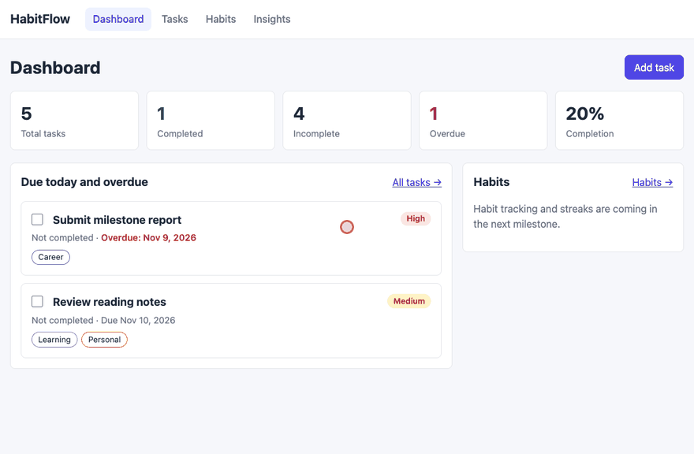
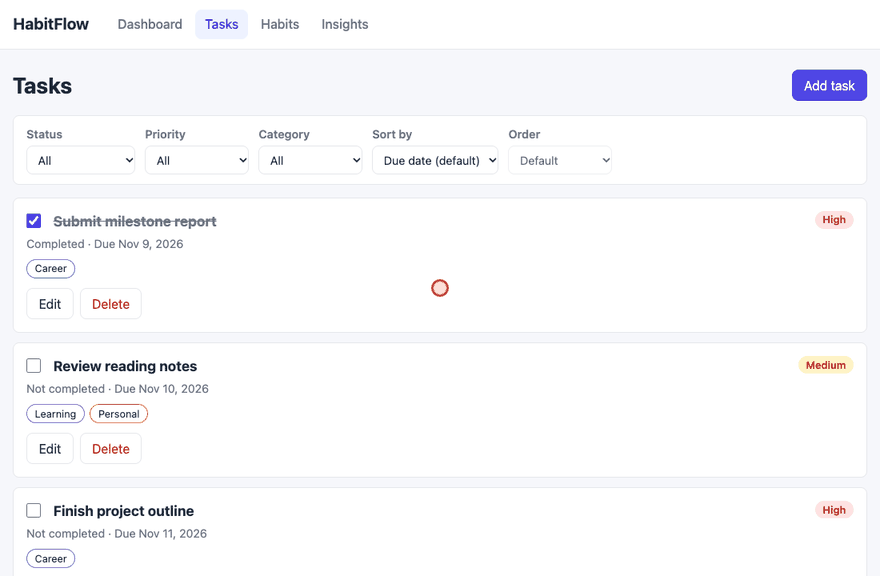
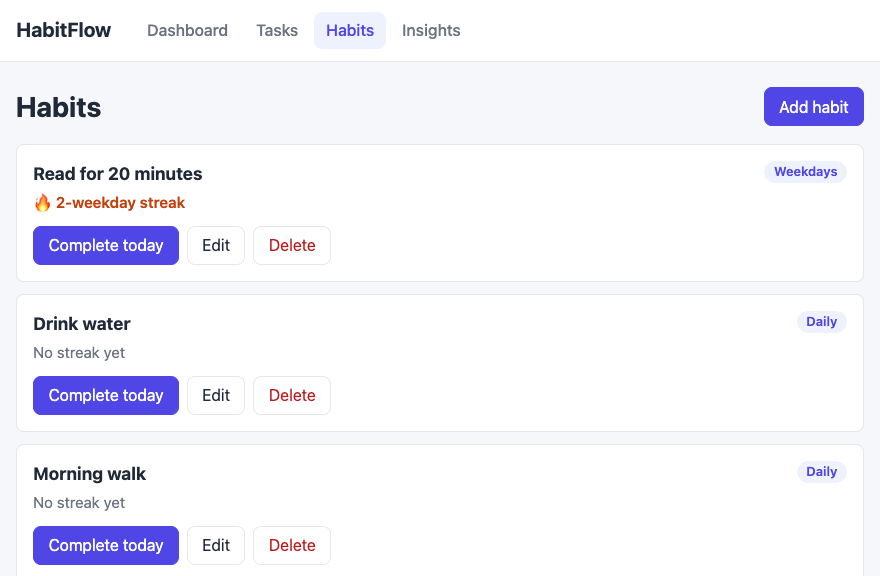
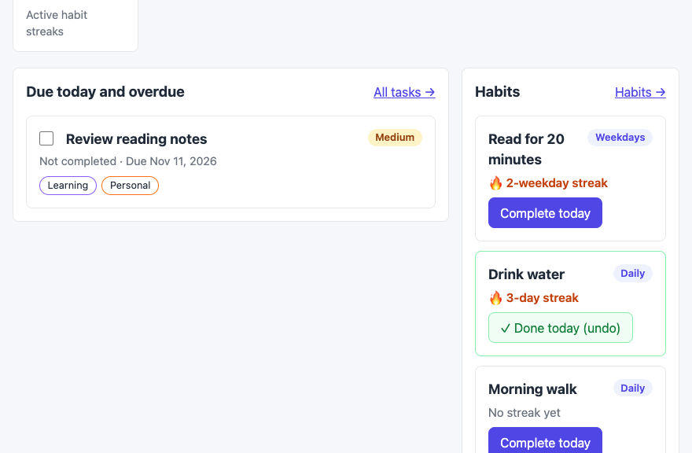
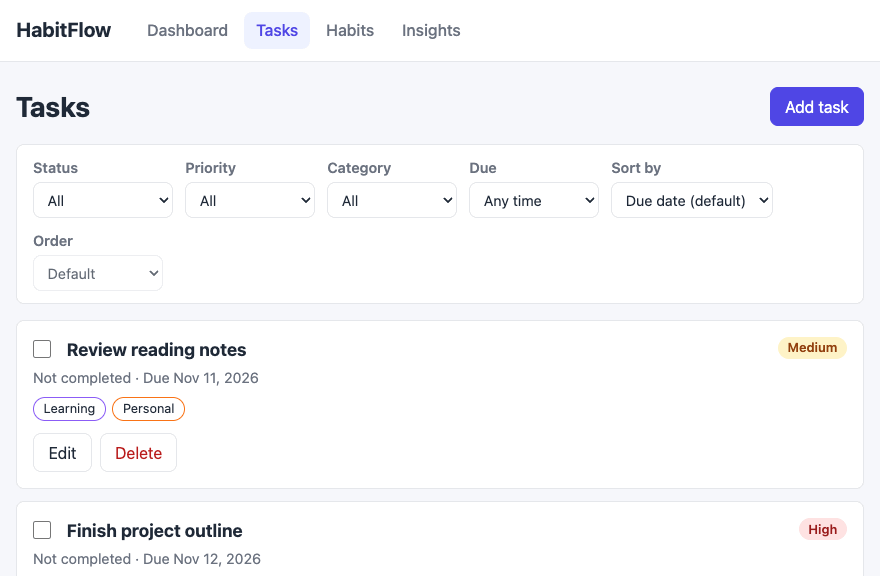
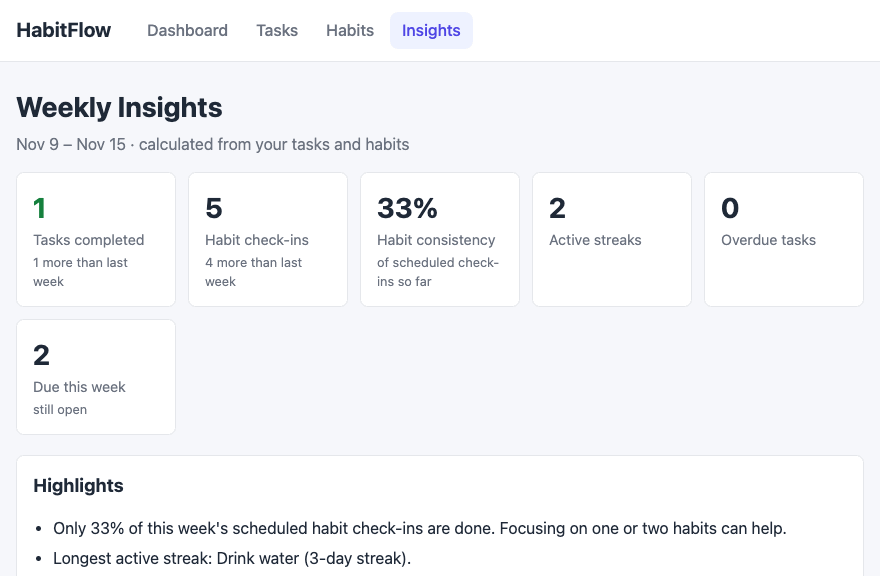

# HabitFlow

Designed and developed by: Mithun Venkatesh Gowda, Bailey Perillo, Anurag Bheemapp

🔗 Link to deployed app:

## About

### Description and Purpose

A full-stack productivity dashboard and habit tracker designed to help users build consistent daily routines, manage tasks efficiently, and receive AI-driven weekly coaching insights, bottleneck analysis, and automated priority suggestions to optimize their personal workflows.

### Inspiration

Inspired by the need for intelligent productivity tools that don't just act as static checklists, but actively provide actionable feedback and data-driven insights on habit formation and time management.

## Tech Stack

Frontend: React, Vite, React Router, CSS

Backend: Node.js, Express.js, RESTful API

Database: PostgreSQL (with one-to-many and many-to-many relationships)

Deployment: Render

## Current Development Progress

Milestone 4 (Unit 8) delivered the full task flow, from the database to the UI:

- React frontend (Vite + React Router) with shared navigation and routes for
  `/`, `/tasks`, `/tasks/:taskId`, `/habits`, `/habits/:habitId`, and `/insights`.
- Tasks page: create, edit, delete, and mark tasks complete, with priority,
  due date, overdue highlighting, and category tags.
- Task details page at `/tasks/:taskId`, with "Task not found." for missing tasks.
- Dashboard with task totals, completed, incomplete, overdue, and completion
  percentage calculated from real data, plus a "Due today and overdue" list.
- Filtering by status, priority, and category, and sorting by due date,
  priority, created date, or title.
- Validation on both the frontend form and the backend API, with clear loading,
  empty, and error states.

The final milestone (Unit 9) completes the app:

- Habits with create, edit, delete, "Complete today" / undo, completion
  history, and current streaks calculated for daily, weekdays, and weekly
  habits.
- Weekly Insights page and a "This week" chart on the Dashboard, calculated
  from real tasks and habit check-ins by `GET /api/insights/weekly`.
- Tasks record when they were completed (`completed_at`), so insights can
  count tasks finished each day.
- A due-date filter on the Tasks page: overdue, due today, next 7 days, or no
  due date.
- "Reset demo data" in the footer restores the database to its seeded state.
- Express serves the built React app, so the whole project deploys as one
  Render web service (`render.yaml`).
- 146 automated backend tests (`npm test`).

### API Reference

| Method | Route | Success | Notes |
| --- | --- | --- | --- |
| `GET` | `/api/health` | `200` | Health check |
| `GET` | `/api/tasks` | `200` | Supports filters and sorting below |
| `GET` | `/api/tasks/:id` | `200` | Includes related `categories` |
| `POST` | `/api/tasks` | `201` | Requires `title` and an existing `user_id` |
| `PATCH` | `/api/tasks/:id` | `200` | Partial update; `due_date: null` clears the date |
| `DELETE` | `/api/tasks/:id` | `204` | No response body |
| `GET` | `/api/categories` | `200` | All categories, sorted by name |
| `GET` | `/api/habits` | `200` | Habits with `current_streak`, `completed_today`, `last_completed_on`, `completion_count` |
| `GET` | `/api/habits/:id` | `200` | One habit with the same calculated fields |
| `POST` | `/api/habits` | `201` | Requires `name` and an existing `user_id`; `frequency` is `daily`, `weekdays`, or `weekly` |
| `PATCH` | `/api/habits/:id` | `200` | Partial update of `name`, `description`, `frequency` |
| `DELETE` | `/api/habits/:id` | `204` | Also deletes the habit's completions |
| `GET` | `/api/habits/:id/completions` | `200` | Completion history, newest first |
| `POST` | `/api/habits/:id/completions` | `201` | Logs a completion (`completed_on` defaults to today); `409` if already logged |
| `DELETE` | `/api/habits/:id/completions/:date` | `200` | Undoes a completion and returns the updated streak |
| `GET` | `/api/insights/weekly` | `200` | Calculated summary of the current Monday–Sunday week (custom non-RESTful route) |
| `POST` | `/api/reset` | `200` | Restores every table to the seed data (custom non-RESTful route) |

Task fields: `title` (non-empty string), `description` (string),
`priority` (`low`, `medium`, `high`), `due_date` (`YYYY-MM-DD` or `null`),
`completed` (`true`/`false`), `category_ids` (array of existing category ids;
replaces the task's categories, `[]` removes them), and `user_id` (create only).
Responses also include `completed_at`, set automatically when a task is
completed and cleared when it is reopened.

List query parameters:

```text
GET /api/tasks?completed=false
GET /api/tasks?priority=high
GET /api/tasks?category=Learning
GET /api/tasks?due=overdue&today=2026-11-11  # overdue | today | week | none
GET /api/tasks?sort=due_date            # due_date | priority | created_at | title
GET /api/tasks?sort=title&order=desc    # order is optional: asc | desc
```

Habit, insights, and due-date routes accept an optional `today=YYYY-MM-DD`
query parameter so streaks and "overdue" use the browser's date; the server's
date is used when it is omitted.

`GET /api/insights/weekly` returns `week` (start, end, today), `days` (habit
check-ins and tasks completed for each day), `tasks` (completed this week and
last week, overdue, due this week, open), `habits` (check-ins this week and
last week, completion rate of scheduled check-ins, active streaks, best
streak, and every habit's streak), `categories` (task counts per category),
and `most_used_category`.

Error responses use the shape `{ "error": "message" }`: `400` for invalid IDs,
fields, query parameters, or malformed JSON; `404` for missing tasks or
habits; `409` for a duplicate habit completion; and `500` only for unexpected
server failures.

## GitHub Project Management

Repository: https://github.com/HabitFlowProject/web103_finalproject

Project board: https://github.com/orgs/HabitFlowProject/projects/2

### Completed Unit 7 Issues

- [#6 Complete HabitFlow planning documents](https://github.com/HabitFlowProject/web103_finalproject/issues/6)
- [#7 Create and configure HabitFlow project board](https://github.com/HabitFlowProject/web103_finalproject/issues/7)
- [#8 Present HabitFlow pitch and record feedback](https://github.com/HabitFlowProject/web103_finalproject/issues/8)

### Completed Unit 8 Issues

- [#1 Implement task REST API CRUD](https://github.com/HabitFlowProject/web103_finalproject/issues/1) ✅
- [#2 Create PostgreSQL schema and seed data](https://github.com/HabitFlowProject/web103_finalproject/issues/2) ✅
- [#3 Build Dashboard and Tasks pages](https://github.com/HabitFlowProject/web103_finalproject/issues/3) ✅
- [#5 Add validation, filtering, sorting, and error handling](https://github.com/HabitFlowProject/web103_finalproject/issues/5) ✅

The backend foundation walkthrough shows the health check and seeded task
response without exposing database credentials.


### Completed Unit 9 Issues

- [#4 Implement habits and completion streaks](https://github.com/HabitFlowProject/web103_finalproject/issues/4) ✅

## Features

### ✅ User Dashboard Overview:

A centralized analytics view displaying daily completion rates, active habit streaks, and productivity scores.

Completed in Unit 8: task totals, completed, incomplete, overdue, and completion
percentage from real data, plus a "Due today and overdue" list where tasks can
be completed without leaving the page. Unit 9 added active habit streaks,
same-page habit completion, and a "This week" chart of habit check-ins and
completed tasks.



### ✅ Habit & Task CRUD Management:

Full create, read, update, edit, and delete capabilities for managing daily habits, recurring tasks, and completion logs.

Completed in Unit 8 for tasks: create and edit in a modal form, mark complete,
delete with confirmation, and a task details page.



Completed in Unit 9 for habits: create, edit, and delete habits, mark them
done today (or undo) without leaving the page, and see the streak update
immediately. Each habit has a details page at `/habits/:habitId` with its
completion history.



### ✅ Category Tagging System (Many-to-Many):

Organize habits and tasks into custom categories (e.g., Health, Career, Learning) with a join table allowing flexible categorization.

Tasks can be tagged with any number of categories through the `task_categories`
join table, and tags are shown on every task.


### ✅ Weekly Coaching & Insights Panel:

A dedicated view where users receive automated summaries and recommendations based on their weekly habit completion patterns.

The insights are calculated from real data (no LLM): tasks completed and
habit check-ins this week compared with last week, the share of scheduled
check-ins done so far, active and best streaks, overdue tasks, a day-by-day
chart, category usage, and highlights such as which streaks need a check-in
today. Real AI-generated coaching remains a stretch goal.



### ✅ Interactive Filtering & Sorting:

Filter tasks and habits by completion status, priority level, or category tags.

Tasks can be filtered by status, priority, and category, and sorted by due
date, priority, created date, or title. Filters are kept in the URL.


Unit 9 added a due-date filter: overdue, due today, the next 7 days, or no due
date.



### ✅ Data Validation & Error Handling:

Robust backend validation on all POST and PATCH requests to ensure clean data input and graceful error messaging across the UI.

The task form checks the title, priority, and due date before saving, and the
API rejects invalid input with a `400` and a clear message. The UI shows
loading, empty, and error states, including "Task not found." for missing tasks.


### ✅ Reset Demo Data:

"Reset demo data" in the footer restores every table to the seeded demo data
after a confirmation, and the current page reloads with the fresh data.



## Installation Instructions

### Backend

```bash
cd backend
npm install
npm run db:schema
npm run db:seed
npm start
```

The backend requires a local ignored `.env` file containing the Render
PostgreSQL connection variables:

```env
PGUSER=
PGPASSWORD=
PGHOST=
PGPORT=5432
PGDATABASE=
NODE_ENV=development
PORT=3000
```

Do not commit `.env` or database credentials.

### Frontend

With the backend running on port 3000, in a second terminal:

```bash
cd frontend
npm install
npm run dev
```

Open http://localhost:5173. In development, Vite forwards `/api` requests to
`http://localhost:3000`. If the backend runs on another port, start the
frontend with `VITE_DEV_API_TARGET=http://localhost:<port> npm run dev`.

### Backend Tests

The API tests use Node's built-in test runner (Node 22 or newer) against
a dedicated local PostgreSQL database. The tests drop and recreate every table
on each run, so they refuse to start unless the database name ends in `_test`
and the host is not on Render.

```bash
createdb habitflow_test
cd backend
cp .env.test.example .env.test   # fill in local credentials; ignored by Git
npm test
```

Values in `backend/.env.test` take priority over `backend/.env` during tests,
so the development and Render databases are never touched.

### Deployment (Render)

The app deploys as a single Render web service: the build step compiles the
React app into `frontend/dist`, and Express serves it alongside the API, with
every non-API route falling back to `index.html` so links like
`/tasks/3` work on refresh. `render.yaml` describes the service.

1. Create a Render PostgreSQL database (or reuse the existing one).
2. In Render, create a **Blueprint** from this repository, or a web service
   with:
   - Build command: `npm run build && npm --prefix backend run db:schema`
   - Start command: `npm start`
   - Health check path: `/api/health`
3. Set the environment variables `PGHOST`, `PGPORT`, `PGUSER`, `PGPASSWORD`,
   `PGDATABASE`, `NODE_ENV=production`, and `NODE_VERSION=22`. Render
   provides `PORT`.
4. After the first deploy, open the app and click **Reset demo data** to load
   the seed data.

`db:schema` only creates missing tables and columns, so it is safe on every
deploy. If the frontend is ever hosted separately, build it with
`VITE_API_BASE_URL=<backend URL>` and set `CORS_ORIGIN=<frontend URL>` on the
backend.

To try the production setup locally:

```bash
npm run build      # from the repository root
PORT=3000 npm start
```
