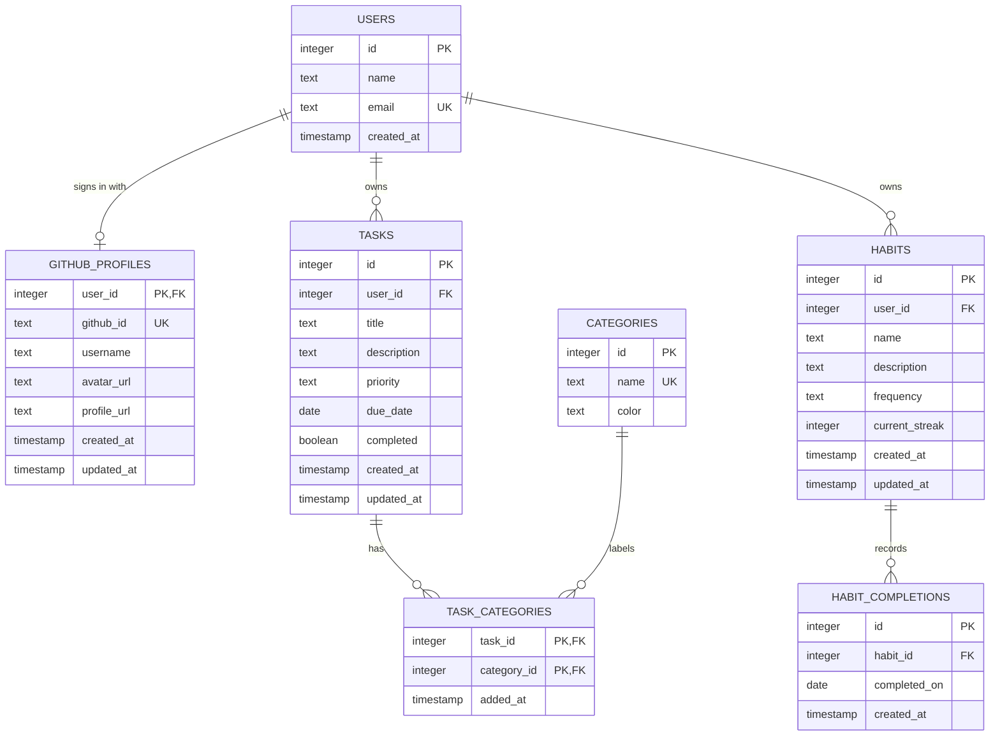

# Entity Relationship Diagram

## List of Tables

- `users`: People who use HabitFlow (the seeded demo user and GitHub sign-ins).
- `github_profiles`: GitHub account details for a user (one-to-one with `users`).
- `session`: Login sessions, stored by `connect-pg-simple`.
- `tasks`: One-time or scheduled work items owned by a user.
- `habits`: Recurring routines owned by a user.
- `habit_completions`: Daily completion records for habits.
- `categories`: Reusable labels such as Health, Career, Learning, Personal,
  and Finance.
- `task_categories`: Join table connecting tasks and categories.

## Entity Relationship Diagram

## Relationship Notes

- `users` to `tasks` is a one-to-many relationship.
- `users` to `habits` is a one-to-many relationship.
- `habits` to `habit_completions` is a one-to-many relationship.
- `tasks` to `categories` is a many-to-many relationship implemented with
  `task_categories`.
- The composite primary key on `task_categories` prevents assigning the same
  category to the same task more than once.
- `users` to `github_profiles` is a one-to-one relationship: `user_id` is
  both the primary key and the foreign key of `github_profiles`, so each user
  has at most one GitHub profile and each profile belongs to one user.
- On a user's first GitHub sign-in, a starter set of tasks and habits is
  created for them automatically.

## Seeded Categories

The initial database state will include:

- Health
- Career
- Learning
- Personal
- Finance
